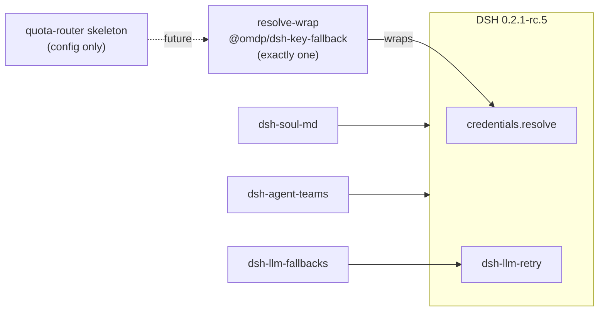

# agent-home-recipes


**[☕ Buy Me a Coffee](https://buymeacoffee.com/kinfxhk)** · [GitHub Sponsors](https://github.com/sponsors/Kinfxhk)

**狀態：M0 scaffold（配方／健康檢查／空 quota-router 契約）——不是生產完整產品。**

KINFX 用的 **DSH 相容** agent home **profile 配方**：一鍵說明安裝、可逆卸載、健康檢查、空的額度路由設定骨架。  
公開名：`agent-home-recipes`（內部曾暫稱 kinfx-dsh-foundation／kinfx-harness-foundation）。  
**同 DeepSeek、xAI 或其他 LLM 廠商無隸屬關係。** 技術段可寫「相容 DSH（DeepSeek Harness）」。

## English (short)

M0 **profile/recipe kit** for a DSH-compatible agent home: install instructions, health-check, and an **empty** quota-router **config contract** (no rotation engine). Default resolve-wrap is **only** `@omdp/dsh-key-fallback` (optional alternative `key-rotation` — never both). Also: `dsh-soul-md`, `dsh-llm-fallbacks`, `@nanmicoder/dsh-agent-teams`. Pin host `@deepseek-ai/dsh@0.2.1-rc.5`. No secrets in repo. MIT.

## 架構示意



*(Placeholder diagram — M0 has no live router engine.)*

## 預設插件（M0）

| 角色 | 套件 | 備註 |
|------|------|------|
| Host | `@deepseek-ai/dsh@0.2.1-rc.5` | 釘 tip |
| Soul | `dsh-soul-md` | 文件／人格 |
| Resolve-wrap（**只一個**） | `@omdp/dsh-key-fallback` | 同 provider key 池 |
| Model 降級 | `dsh-llm-fallbacks` | 不取代 credentials 池 |
| Teams | `@nanmicoder/dsh-agent-teams` | activity 暫代 |
| 可選替代 wrap | `@goodandready/dsh-key-rotation` | **代替** key-fallback，不並裝 |
| 禁裝 | `dsh-subagent-progress`、`dsh-bridges` | 對 0.2.1-rc.5 不相容 |

詳見 [`profiles/default/COMPATIBILITY.md`](profiles/default/COMPATIBILITY.md) · [`docs/boundaries.md`](docs/boundaries.md)

## 一鍵安裝（可逆）

```bash
cd /path/to/agent-home-recipes
export DSH_HOME="${DSH_HOME:-$HOME/.agent-home-recipes-dsh}"
mkdir -p "$DSH_HOME"
npm i -g @deepseek-ai/dsh@0.2.1-rc.5

# 只印指令：
npm run install:profile

# 真正寫入 web profile（需要 dsh + DSH_HOME）：
npm run install:profile -- --apply

npm run healthcheck
```

密鑰只放 `$DSH_HOME/.credentials.yaml` 或你自管 secret store。本庫只有空的 [`.env.example`](.env.example)。

### 卸載／還原

```bash
npm run uninstall:profile -- --apply
# 或刪走專用 home（只影響該 DSH_HOME）：
# rm -rf "$DSH_HOME"
```

## 健康檢查

```bash
npm run check          # 檔案／配方政策／health --dry／粗略 secret 掃描
npm run healthcheck    # 有 dsh 時查版本＋dump-config
npm run healthcheck -- --dry   # 無 dsh 亦可
```

## Quota router 骨架

- [`config/quota-router.schema.json`](config/quota-router.schema.json) — 契約  
- [`config/quota-router.example.yaml`](config/quota-router.example.yaml) — 註解例子（無 key）  

**M0 無輪換引擎。** 池＝wrap resolve；降級＝llm-fallbacks；重試＝宿主 llm-retry。

## 合規

多帳／多 key 自動輪換可能受各供應商 ToS 限制。正式對外／長期使用前交法律顧問對官方 ToS **開頁**核實。本專案**不**提供繞過步驟。

若你配置多個 credential／帳號，須確保每一項均符合該供應商現行服務條款與使用政策（包括對多帳號、帳號共享、限流與計費之限制）；本專案**不**協助亦**不**建議以多帳號規避使用限制或計費義務。

*Not legal advice; users must comply with each provider’s Terms/AUP; no secrets in git. Multi-credential routing is only for credentials you are authorized to use; it is not a rate-limit or billing circumvention tool.*

## 授權

MIT · Copyright (c) 2026 KINFX · 見 [LICENSE](LICENSE) / [NOTICE](NOTICE)
